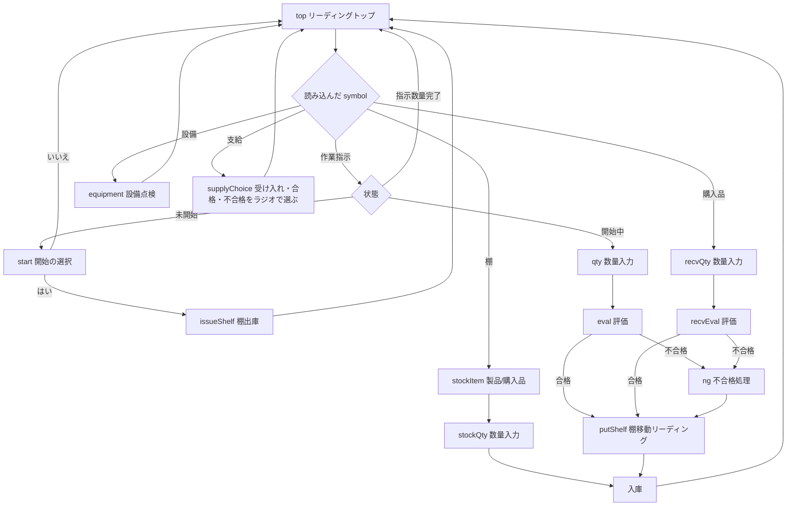

# barcode_entry

バーコード実績登録。バーコードリーダー(キーボード入力として届く)・スマートフォン・タブレットから symbol を読み込み、作業実績・受入検品・棚移動・設備点検を進める。Windows アプリのほか、実績登録専用のアプリ(Android のバーコードリーダーデバイス、スマートフォン)での利用を想定する。`packages/features/CLAUDE.md` の[規則/仕様]を必ず適用する。
プロジェクト名は、バーコードで実績を登録する役割から `barcode_entry` とした。画面の参照元は `tools/open-design` のメニュー「作業実績 › バーコード」。

## 画面
1.  リーディングトップ(`BarcodeEntryDestination` → `/barcode`、メニュー「作業実績 › バーコード」): バーコード読込 / テキスト入力(Enter・リーダーの確定で決定)。種類のモード(作業実績・受入検品・棚移動・設備点検・支給)を選ぶとその種類だけ受け付け、選ばなければ種類を自動で判定する。
2.  流れは1画面の中で段階(`ScanStep`)を進める。`BarcodeEntryDestination.symbol` を渡すと、開いた直後にその symbol を読み込んだものとして進める(symbol ショートカット用)。
3.  画面は `app_shell` の `ScreenScaffold` で作る。履歴(直近20件)を画面の下に出す。

## コード体系(バーコードの文字列)
バーコードの文字列は `<コード 2 文字><symbol>`。コード = メニューの種類、symbol = DB の対象(`リニアシンボル`。0-9 と A-Z の 33進数で、O・L・I は含まない。`tools/database/仕様/バーコードNo仕様.md`)。ルートの `CLAUDE.md` の「バーコードの体系」の実装。
| コード | メニュー | 対象の種類(`SymbolKind`) |
|---|---|---|
| `WR` | 作業実績(作業指示書の工程。N 工程目は工程ごとの symbol が決める) | work |
| `RC` | 受入検品(発注明細) | purchase |
| `SM` | 棚移動 | shelf |
| `CN` | コンテナ | shelf |
| `EQ` | 設備点検 | equipment |
| `IT` | 品目(製品識別ラベル) | item |
| `SP` | 支給(顧客支給の受け入れ・検品) | supply |
1.  コードと symbol の分解は `BarcodeCode.parse`(大文字小文字を区別しない)。画面・流れはコードの形式を知らない(`ScanFlow` だけが分解して、取得元に symbol を渡す)。
1.  コード付きは、コードを外した symbol を照会し、コードの種類と対象の種類が一致したときだけ採用する。一致しない・見つからないときは、全体を従来の symbol として照会する(コードの無い従来の symbol も、コードに似た接頭辞の symbol もそのまま読める)。
1.  発行(印刷)は `BarcodeCode.encode(symbol)`。symbol は DB のトリガーが付けるので、DB は変えない。
1.  他の画面からの遷移は `BarcodeEntryDestination(code:, symbol:, itemSymbol:)`。`symbol`(棚など)を読み込んだ次に `itemSymbol`(品目)を読み込んだものとして進める(例: 棚移動で棚と品目を読み込んだ状態から、数量入力を始める)。パスは `/barcode?symbol=<コード付き>&item=<コード付き>`。

## 構成(画面とビジネスロジックの分離)
ビジネスロジックは新しいパッケージにせず、このプロジェクトの `lib/src/logic` に分ける(画面は `lib/src/page`)。登録・照会の実体は取得元の窓口に閉じるので、別のプロジェクトへ切り出すときはここをそのまま移せる。
| 種別 | ファイル | 内容 |
|---|---|---|
| 実装の入口 | `lib/barcode_entry.dart` | アプリだけが読み込む(モジュール・流れ・取得元の窓口) |
| 契約の入口 | `lib/barcode_entry_api.dart` | 遷移先の型(`BarcodeEntryDestination`) |
| コード | `lib/src/barcode_code.dart` | `BarcodeCode`(コードの一覧・分解・付加。契約の入口から公開) |
| 対象・種類 | `lib/src/logic/scan_models.dart` | `ScanTarget`(作業指示・棚・購入品・製品/購入品・設備)、`ScanMode`、`StockSource` ほか |
| 流れ | `lib/src/logic/scan_flow.dart` | `ScanFlow`(State)。段階ごとの判定と登録。通知・履歴は種類(enum)で持つ |
| 取得元 | `lib/src/logic/scan_gateway.dart` | `IScanGateway`(Strategy)。照会 `find`、棚出庫 `startWork`、入庫 `putAway`、点検 `recordInspection` |
| 暫定の取得元 | `lib/src/logic/in_memory_scan_gateway.dart` | メモリ上のサンプル(プロトタイプと同じ値)。GraphQL 版は `scanGatewayProvider` を差し替える |
| GraphQL の取得元 | `lib/src/logic/graphql_scan_gateway.dart` | `GraphqlScanGateway`(Adapter)。`barcode_entry_model` の `ScanClient` だけを使い、生成された型を読み込まない。登録は作業実績・ビジター・入庫を、クライアントで順に呼ぶ組み合わせ |
| 画面 | `lib/src/page/` | ページ・モジュール・遷移先・パス・種類から文字列への変換 |
| 文字列 | `lib/src/i18n` | slang の Yaml(日本語。`string_interpolation: braces`) |

## 支給の受け入れ・検品(`SP`)
1.  1つの画面(`supplyChoice`)で、ラジオボタンから「受け入れ(仮止めにする)」「検品に合格(仮止めを外す)」「検品で不合格(異常を登録。仮止めのまま)」を選び、数量を入れて登録する。選択肢は画面だけの値で、`ScanFlow.registerSupply` へは boolean(`receive`・`hold`)で渡す(受け入れ = `receive`、合格 = どちらも false、不合格 = `hold` だけ true)。
1.  数量の上限は取得元の値(`SupplyTarget.remaining` = 未受入、`held` = 仮止め中)。受け入れは未受入まで、合格・不合格は仮止め中まで。画面で計算しない。
1.  メモリ上の取得元は動く。GraphQL 版(`GraphqlScanGateway`)は、支給の照会・登録が未対応(`registerSupply` は `UnsupportedError`、`SP` は未登録の通知になる)。対応は、支給の取得元(`VSupplyDetailBalance`)と登録の関数(`supply_register`)の通信確認のあと。

## 実績登録の画面へのリンク
作業指示を読み込むと、概要の下に「実績登録の画面を開く」(キー `openWorkRegister`)を出す。押すと、その生産計画を先頭にして実績登録(`work_record` の `WorkRegisterDestination(planId:)`。契約 `work_record_api.dart` だけに依存)を CommandBus で開く。生産計画の id は作業指示の対象(`WorkOrderTarget.operationsPlanId`)が持つ(GraphQL 版は `ScanFound.operationsPlanId`)。分からないときと、実績登録の画面を持たないアプリ(`entry_app` が `openWorkRegisterLinkProvider` を false に上書き)では出さない。

## 処理待ち(キュー)
入出庫(作業の開始の棚出庫・入庫。`QueuedIssue`・`QueuedPut`)をその場で登録せず、処理待ちにためて「まとめて登録(N件)」できる(画面案 6.4)。`batchQueueProvider`(既定 false)が true のときだけ。目的は、ハンディ端末で 1 件ごとに通信せず連続して読み取ること。有効にするのは、担当者を引ける取得元と、通信できる環境での確認(`issue/20261120_0001.md`)が済んでから。`example` と各アプリは有効にしていない。キューは画面内のメモリだけに持つ(保存・復元しない)。`ScanFlow.flushQueue` は順に登録し、途中で失敗したら残りのキューを消して理由(`NoticeKind.queueFailed`)を通知する。`removeQueued` で 1 件ずつ取り消せる。担当者の読み取り(`requireOperatorProvider`、既定 false。取得元の `findOperator`。GraphQL 版は未対応で null)と、選んだ棚を残して次の合格の棚の読み取りを省く動き(`selectedShelf`)を持つ。入庫先を読み取る段階では、同じ品目の棚(合格)・不良品棚(不合格。`ShelfTarget.reject`)をおすすめに出し(`recommendShelves`)、棚を読み取ると中身(持っているアイテム・入れ子。`contentsOf`)を出す。GraphQL 版は両方未対応(空・null)。操作なしが `idleTimeoutProvider`(既定 30 秒)続くと、処理待ちを消してトップへ戻る(`ScanFlow.idleClear`。自動では登録しない。残り `idleWarningProvider`(10 秒)から案内)。
1.  画面は、状態(`ScanFlow`)を 1 つにして、ブロックを並べ替える。PC・タブレット(`view_responsiveness` がモバイル以外)は左に読み取り・入力・おすすめ、右に処理待ち・棚の中身・履歴。モバイルは 1 列に積む。画面のライブラリを 2 つに分けない。

## 規則
1.  symbol の種類は取得元が判定する。画面・流れは symbol の接頭辞を知らない。設備はコードで引く。大文字小文字は区別しない。
2.  エラーは文字列ではなく種類(`NoticeKind`・`LogKind`)で持ち、画面が表示時に文字列へ変換する。やり直しを求める通知は `isError`。
3.  取得元の失敗(通信など)は、ログ(`[barcode_entry]` 付き)に残し、利用者へは「登録できませんでした」の通知を出して同じ段階にとどまる(再試行できる)。取得元との通信中は入力を受け付けない。
4.  数量は1以上の整数。作業指示は残り数量、購入品は発注数量の残りを超えられない。不合格は理由を決めて入庫する(`RejectReason`)。
5.  カメラ読み取り(Android・iOS)は `CameraScanner`(`mobile_scanner`)。読んだ文字列はリーダーの入力と同じ入口(`ScanFlow.submit`)へ渡す。数量の段階では出さない。
6.  試すための symbol の一覧は、取得元がメモリ上のサンプルのときだけ画面に出す。

## example
実績登録専用のアプリは `apps/entry_app`(Android・Windows)。このプロジェクトだけを載せる。

`example` は `feature_shared` の `FeatureHost` でこの機能だけを載せる。`flutter run -d windows`。起動と symbol の読み込みは `example/test/widget_test.dart`、流れの判定は `test/barcode_entry_test.dart`。

## GraphQL 版の制限
棚出庫(払出)・単位・設備点検・異常の登録は、DB の構成から決められず未対応(`issue/20261031_0003.md`)。不合格の理由は備考に残す。登録の通信テストは書かない(読み取り専用)。モデルは `packages/model_providers/barcode_entry_model` だけに依存する。

## 規則: プロジェクト間をまたぐ指示
指示や実装が、プロジェクト(アプリ・ライブラリ)をまたいで行われるときの`issue`・`doc/log`の扱い。
1.  指示をしたプロジェクト
    1.  `doc/log`に、指示の内容・指示した先のプロジェクト・実施した結果を記録する。
2.  指示を受けたプロジェクト
    1.  指示の内容と、指示をしたプロジェクトを`issue`に追加する。
    2.  実施した結果を`doc/log`に記録する。
