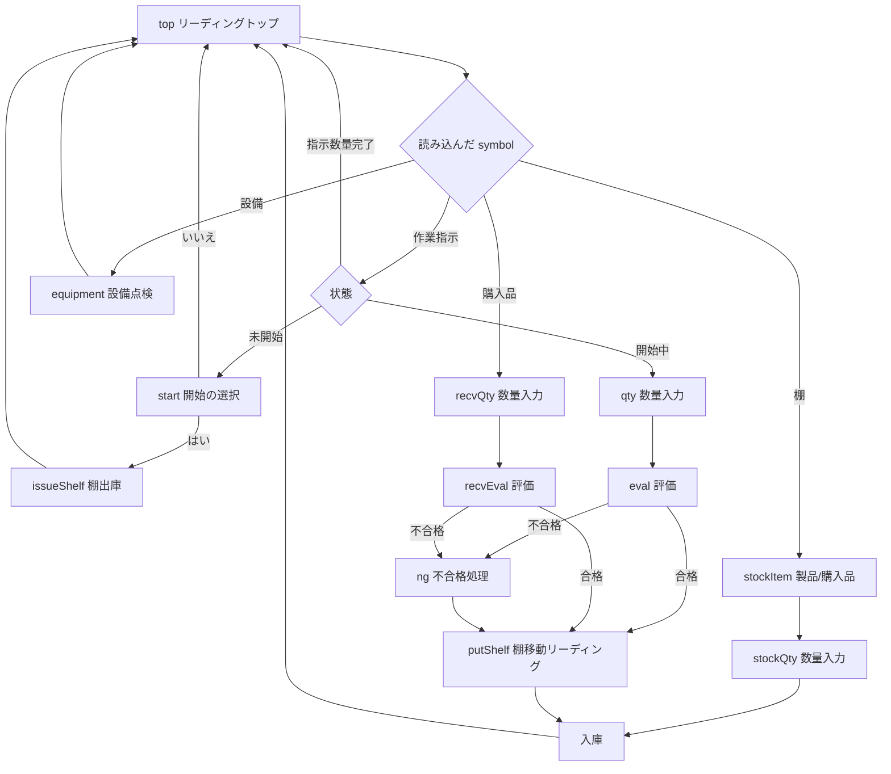

# barcode_entry

バーコード実績登録。バーコードリーダー(キーボード入力として届く)・スマートフォン・タブレットから symbol を読み込み、作業実績・受入検品・棚移動・設備点検を進める。Windows アプリのほか、実績登録専用のアプリ(Android のバーコードリーダーデバイス、スマートフォン)での利用を想定する。`packages/features/CLAUDE.md` の[規則/仕様]を必ず適用する。
プロジェクト名は、バーコードで実績を登録する役割から `barcode_entry` とした。画面の参照元は `tools/open-design` のメニュー「作業実績 › バーコード」。

## 画面
1.  リーディングトップ(`BarcodeEntryDestination` → `/barcode`、メニュー「作業実績 › バーコード」): バーコード読込 / テキスト入力(Enter・リーダーの確定で決定)。種類のモード(作業実績・受入検品・棚移動・設備点検)を選ぶとその種類だけ受け付け、選ばなければ種類を自動で判定する。
2.  流れは1画面の中で段階(`ScanStep`)を進める。`BarcodeEntryDestination.symbol` を渡すと、開いた直後にその symbol を読み込んだものとして進める(symbol ショートカット用)。
3.  画面は `app_shell` の `ScreenScaffold` で作る。履歴(直近20件)を画面の下に出す。

## 構成(画面とビジネスロジックの分離)
ビジネスロジックは新しいパッケージにせず、このプロジェクトの `lib/src/logic` に分ける(画面は `lib/src/page`)。登録・照会の実体は取得元の窓口に閉じるので、別のプロジェクトへ切り出すときはここをそのまま移せる。
| 種別 | ファイル | 内容 |
|---|---|---|
| 実装の入口 | `lib/barcode_entry.dart` | アプリだけが読み込む(モジュール・流れ・取得元の窓口) |
| 契約の入口 | `lib/barcode_entry_api.dart` | 遷移先の型(`BarcodeEntryDestination`) |
| 対象・種類 | `lib/src/logic/scan_models.dart` | `ScanTarget`(作業指示・棚・購入品・製品/購入品・設備)、`ScanMode`、`StockSource` ほか |
| 流れ | `lib/src/logic/scan_flow.dart` | `ScanFlow`(State)。段階ごとの判定と登録。通知・履歴は種類(enum)で持つ |
| 取得元 | `lib/src/logic/scan_gateway.dart` | `IScanGateway`(Strategy)。照会 `find`、棚出庫 `startWork`、入庫 `putAway`、点検 `recordInspection` |
| 暫定の取得元 | `lib/src/logic/in_memory_scan_gateway.dart` | メモリ上のサンプル(プロトタイプと同じ値)。GraphQL 版は `scanGatewayProvider` を差し替える |
| 画面 | `lib/src/page/` | ページ・モジュール・遷移先・パス・種類から文字列への変換 |
| 文字列 | `lib/src/i18n` | slang の Yaml(日本語。`string_interpolation: braces`) |

## 規則
1.  symbol の種類は取得元が判定する。画面・流れは symbol の接頭辞を知らない。設備はコードで引く。大文字小文字は区別しない。
2.  エラーは文字列ではなく種類(`NoticeKind`・`LogKind`)で持ち、画面が表示時に文字列へ変換する。やり直しを求める通知は `isError`。
3.  取得元の失敗(通信など)は、ログ(`[barcode_entry]` 付き)に残し、利用者へは「登録できませんでした」の通知を出して同じ段階にとどまる(再試行できる)。取得元との通信中は入力を受け付けない。
4.  数量は1以上の整数。作業指示は残り数量、購入品は発注数量の残りを超えられない。不合格は理由を決めて入庫する(`RejectReason`)。
5.  カメラ読み取り(Android・iOS)は `CameraScanner`(`mobile_scanner`)。読んだ文字列はリーダーの入力と同じ入口(`ScanFlow.submit`)へ渡す。数量の段階では出さない。
6.  試すための symbol の一覧は、取得元がメモリ上のサンプルのときだけ画面に出す。

## example
実績登録専用のアプリは `apps/entry_app`(Android・Windows)。このプロジェクトだけを載せる。

`example` は `feature_shared` の `FeatureHost` でこの機能だけを載せる。`flutter run -d windows`。起動と symbol の読み込みは `example/test/widget_test.dart`、流れの判定は `test/barcode_entry_test.dart`。
