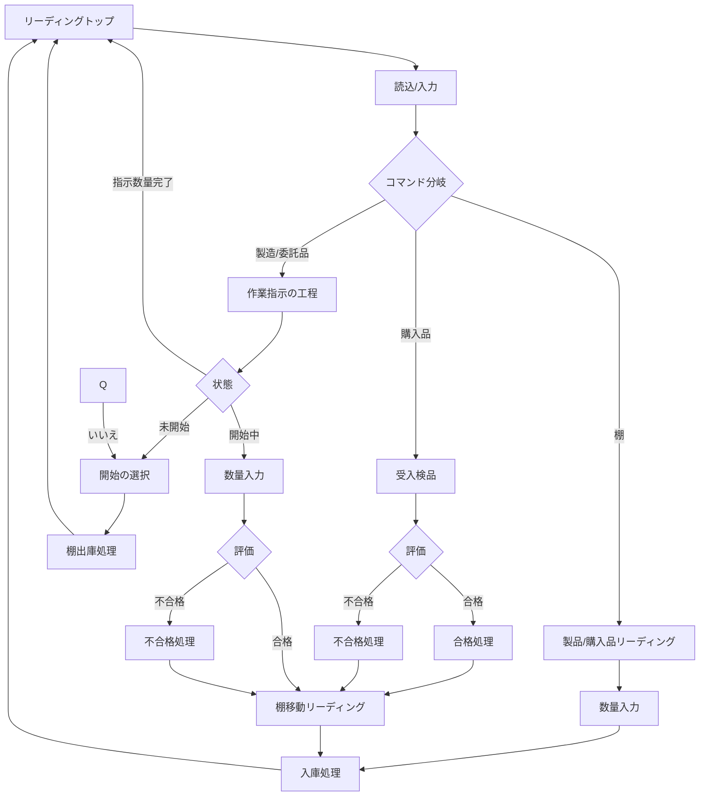

#   画面追加仕様
新しいプロジェクトとして生成。Windowsアプリの他、実績登録専用アプリ(バーコードリーダーデバイス(Android)、スマートフォン)で使用されることを想定する。プロジェクト名は適切なものを選択する。
##  バーコードリーダー/スマートフォン/タブレットから読み込むシンボルの動作
`flutter-pms\tools\open-design\index.html`のメニュー`作業実績->バーコード`を参照する。
1.  リーディングトップ
    1.  バーコード読込/テキスト入力(エンター、バーコーリーダーコミットで決定)
    1.  作業実績
    1.  受入検品
    1.  棚移動
    1.  設備点検
### バーコード(symbol)からコマンド
このビジネスロジックが画面の責務の範囲ではないとき、モデルまたはあらたなビジネスロジックプロジェクトとするか決定する(おそらく、画面プロジェクトの中で分離)。
以下は、このプロジェクトのフロー。大幅に影響を与える判断が必要な課題は随時Issueとして提案、ロジックを大幅に変更することなく対応できるものは、まとめて提案を含めてIssueへ追加する。

