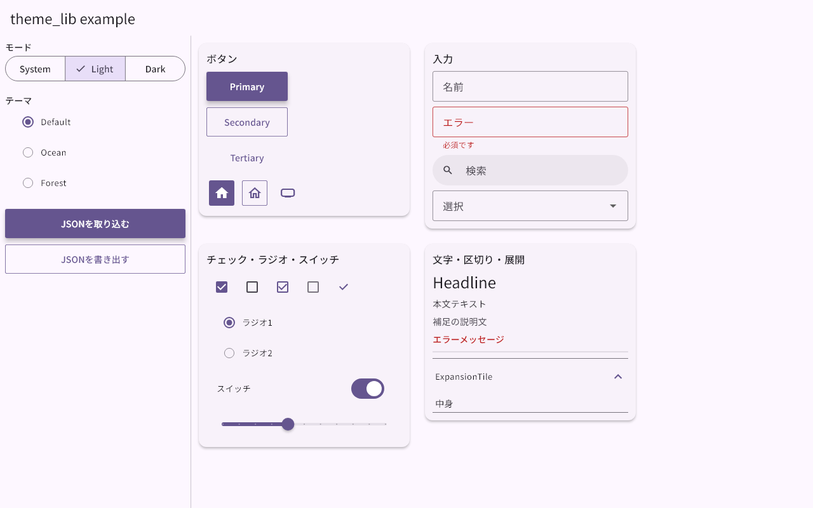
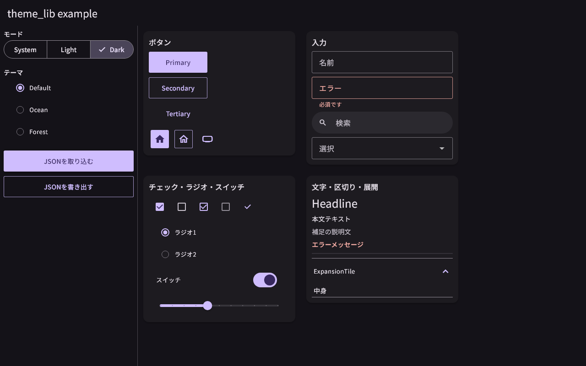
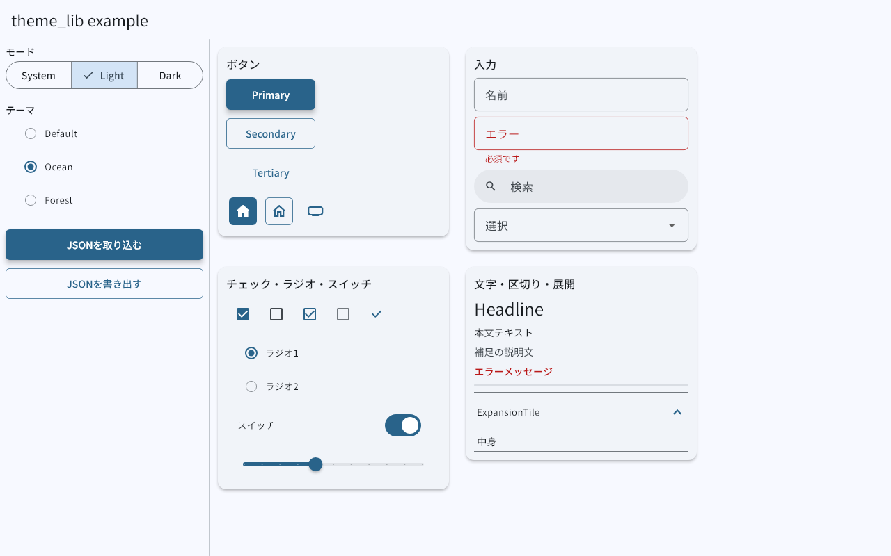
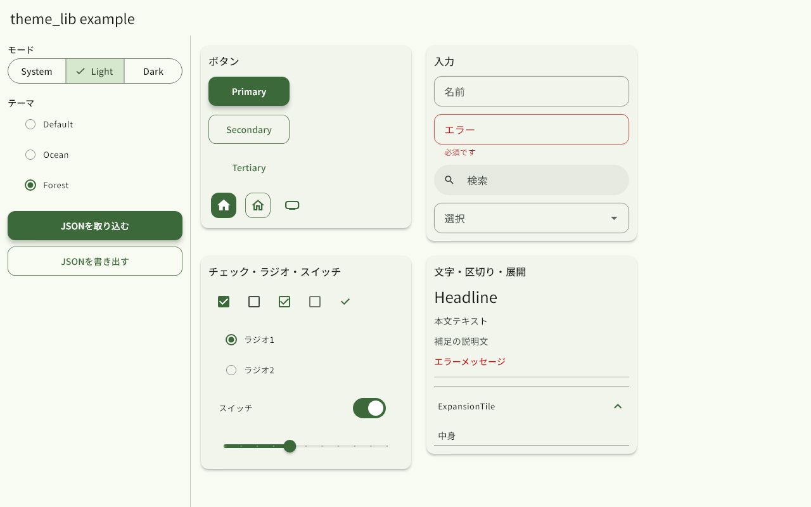
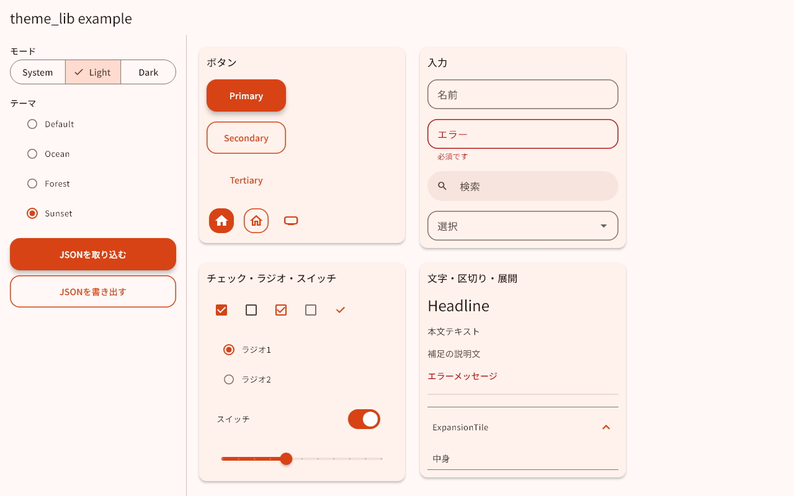
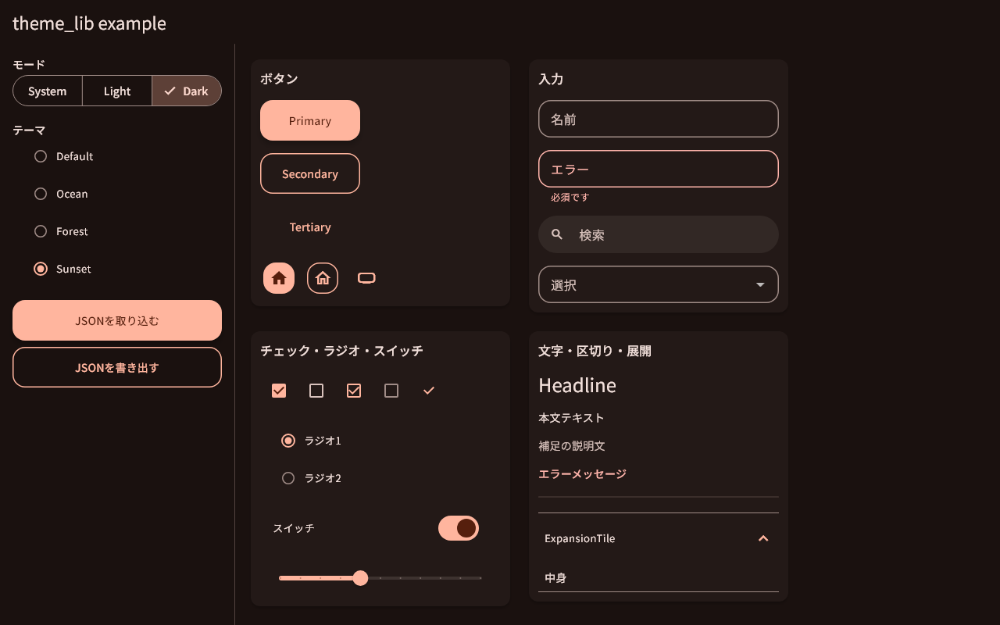

# 🎨 theme_lib 使い方ガイド

アプリ全体の見た目を **1か所で統一** し、**実行中に着せ替え** できるテーマ管理ライブラリです。

- 🌗 システム / ライト / ダークの切り替え
- 🧩 JSON からのテーマ取り込み・書き出し（ユーザーが自分で作れます）
- ⚡ すべてオンザフライ。切り替えた瞬間に画面へ反映されます
- 🧰 ボタン・入力欄・チェックボックスなどの見た目をテーマ値から自動で揃える拡張

画像はすべて [example](../../example/lib/main.dart) アプリの実画面です。再生成は `example` で
`flutter test tool/screenshots_test.dart` を実行します。

---

## 📦 1. 組み込む

```yaml
dependencies:
  theme_lib:
    path: ../theme_lib        # 配置に合わせて変更
```

`import 'package:theme_lib/theme_lib.dart';` の **1行だけ** で全機能を使えます。

---

## 🔌 2. アプリに接続する（3ステップ）

### ① ロガーを差し込む 📝

theme_lib は **自分の失敗だけ** をログに残します（メッセージは `[theme_lib]` で始まります）。
アプリ共通の `ILoggerProvider`（`logger_provider` パッケージ）を `ProviderScope` で渡してください。
未設定のまま使うと「`themeLoggerProvider is not overridden`」と分かりやすく教えてくれます。

```dart
ProviderScope(
  overrides: [themeLoggerProvider.overrideWithValue(appLogger)],
  child: const MyApp(),
)
```

### ② MaterialApp につなぐ 🔗

```dart
class MyApp extends ConsumerWidget {
  const MyApp({super.key});

  @override
  Widget build(BuildContext context, WidgetRef ref) => MaterialApp(
    theme: ref.watch(lightThemeProvider),
    darkTheme: ref.watch(darkThemeProvider),
    themeMode: ref.watch(themeModeProvider),
    home: const HomePage(),
  );
}
```

### ③ 切り替えは管理インスタンスへ 🎛️

```dart
final manager = ref.read(themeManagerProvider.notifier);

manager.setMode(ThemeMode.dark);   // システム / ライト / ダーク
manager.select('ocean');           // 登録済みテーマへ切り替え
```

---

## 🌗 3. ライト / ダークを切り替える

`ThemeMode.system` ならOSの設定に追従し、`light` / `dark` で固定できます。
ダーク用の配色は、ライト用のシード色から **自動で生成** されます（JSONで個別指定も可能）。

| ライト | ダーク |
| --- | --- |
|  |  |

---

## 🎭 4. テーマを切り替える

標準で3種類が登録されています。**角丸・余白・ボタン高さ** もテーマごとに変わります。
組み込みテーマは削除できません。

| `default` | `ocean`（角丸 6） | `forest`（角丸 12・余白 6） |
| --- | --- | --- |
|  |  |  |

```dart
final state = ref.watch(themeManagerProvider);
state.themes.values;   // 登録済みテーマの一覧
state.activeId;        // 適用中の id
```

---

## 📥 5. JSON からテーマを取り込む

構造が正しい JSON なら、実行中に新しいテーマを追加できます。取り込むと既定ではすぐ適用されます。

```dart
final definition = manager.importJson(jsonString);               // 取り込んで適用
manager.importJson(jsonString, activate: false);                 // 登録だけ
```

| ライト | ダーク（`dark` を省略 → 自動生成） |
| --- | --- |
|  |  |

### 📜 JSON の書き方

```json
{
  "schemaVersion": 1,
  "id": "sunset",
  "name": "Sunset",
  "fontFamily": "Meiryo",
  "light": {
    "seedColor": "#E65100",
    "colors": { "primary": "#D84315" }
  },
  "dark": { "seedColor": "#FF8A65" },
  "metrics": {
    "spacing": 8,
    "radius": 16,
    "borderWidth": 1.5,
    "buttonHeight": 52
  }
}
```

| キー | 必須 | 説明 |
| --- | :-: | --- |
| `schemaVersion` | | 省略可。現在は `1` のみ |
| `id` | ✅ | `[a-z0-9][a-z0-9_-]{0,63}`。同じ id は **置き換え** |
| `name` | ✅ | 表示名（64文字まで） |
| `fontFamily` | | アプリ側で登録済みのフォント名 |
| `light.seedColor` | ✅ | `#RRGGBB` または `#AARRGGBB` |
| `light.colors` | | 個別上書き。`primary` `onPrimary` `secondary` `onSecondary` `tertiary` `onTertiary` `error` `onError` `surface` `onSurface` `outline` |
| `dark` | | `light` と同じ形。省略するとライトのシード色から自動生成 |
| `metrics` | | 下表の数値（0〜256）。省略した項目は既定値 |

`metrics` の項目と既定値: `spacing` 4 / `formFieldPadding` 4 / `menuFieldPadding` 8 / `radius` 3 /
`fullRadius` 32 / `borderWidth` 0.8 / `activeBorderWidth` 1 / `buttonHeight` 46 /
`buttonWidth` 128 / `buttonElevation` 2 / `iconButtonSize` 32

### 🚨 不正な JSON のとき

状態は **変わりません**。`ThemeFormatException` が投げられ、`[theme_lib]` のエラーログが1件残ります。
`path` で不正箇所が分かります。

```dart
try {
  manager.importJson(source);
} on ThemeFormatException catch (e) {
  print(e.path);     // 例: metrics.radius
  print(e.message);  // 例: metrics.radius: must be a number between 0.0 and 256.0
}
```

未知のキーも **エラー** にします（打ち間違いを見逃さないため）。

---

## 📤 6. JSON へ書き出す

```dart
final json = manager.exportJson('sunset');   // 整形済み。pretty: false で1行
```

書き出した JSON はそのまま取り込めます（往復で同じ定義になります）。ファイル保存や共有はアプリ側で行ってください。

---

## ✏️ 7. 登録済みテーマを変更する・消す

```dart
final current = ref.read(themeManagerProvider).themes['sunset']!;
manager.register(current.copyWith(name: 'Sunset 2'), activate: true);  // 同じ id を置き換え
manager.remove('sunset');   // 適用中なら先頭の組み込みテーマへ戻る
```

画面で色やフォントを編集するUIを作る場合も、`ThemeDefinition` を作って `register` するだけです。

---

## 🧰 8. 見た目を揃える拡張

テーマの値（角丸・線幅・色）に合わせて、ウィジェットを **3種類の見た目** に変換します。

| 種類 | 見た目 |
| --- | --- |
| `primary` | 塗りつぶし |
| `secondary` | 枠線 |
| `tertiary` | 文字（アイコン）のみ |

```dart
FilledButton(onPressed: () {}, child: const Text('保存')).toPrimary(context);
FilledButton(onPressed: () {}, child: const Text('戻る')).toSecondary(context);
IconButton(onPressed: () {}, icon: const Icon(Icons.home)).toTertiary(context);
Checkbox(value: true, onChanged: (_) {}).toSecondary(context);
CheckboxListTile(value: true, onChanged: (_) {}, title: const Text('同意')).toPrimary(context);
```


`toVariant(context, ThemeVariant.primary)` で種類を変数から指定することもできます。

### 🔍 検索窓

```dart
TextFormField(decoration: const InputDecoration(prefixIcon: Icon(Icons.search))).toSearch(context);
```

丸い角・枠線なし・塗りつぶしの検索窓になります（`TextField` も同様）。
通常の入力欄やドロップダウンは **テーマ全体に適用済み** なので変換は不要です。

### 📏 余白

```dart
const Text('a').spaceAll(context);        // 全周
const Text('b').spaceHorizontal(context); // 左右
const Text('c').spaceVertical(context);   // 上下
Row(spacing: context.spacing, children: [/* ... */]);
```

値はテーマの `metrics.spacing` です（上の `forest` のように余白ごと変わります）。

### 🔤 文字

```dart
Text('見出し', style: context.textStyleMode(size: (t) => t.headlineSmall));
Text('補足', style: context.textStyleMode(color: TextColorStyleMode.secondary));
Text('エラー', style: context.textStyleMode(color: TextColorStyleMode.error));
```

---

## 🧪 9. エラー追跡のための JSON 化

`ThemeDefinition` / `ThemeState` / `SpaceField` / `BorderField` / 各例外は `toJson()` を持ちます。
ログやエラーレポートへ載せるための機能で、**状態の復元には使いません**
（定義の復元は `ThemeDefinition.parse` / `importJson` を使ってください）。

---

## ⚠️ 10. 知っておくこと

- 🔒 `default` / `ocean` / `forest` は削除できません（`ThemeProtectedException`）。
- 🔎 存在しない id の `select` / `exportJson` / `remove` は `ThemeNotFoundException` です。
- 💾 テーマはメモリ上のみ保持します。再起動後も残したいときは `exportJson` した内容をアプリ側で保存し、起動時に `importJson` してください。
- 🏗️ `ThemeBuilder.build(definition, brightness)` を直接呼べば、Riverpod を使わずに `ThemeData` を作れます。
- 📝 ログに残るのは theme_lib 側の失敗（不正なJSON・未登録のid・組み込みの削除）だけです。
