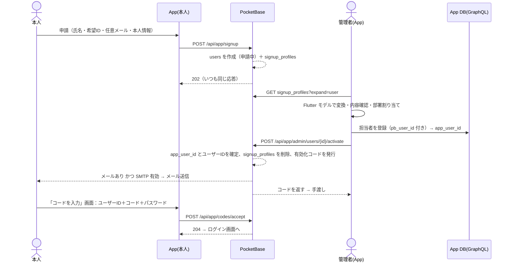
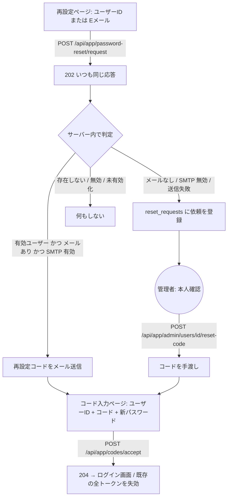

# App ログインサービス (PocketBase / Docker Compose)

Flutter アプリ (App) 向けに、次の3つを PocketBase で提供します。

- **認証:** 登録申請 → 管理者の承認 → コードでパスワード設定
- **セッション管理**
- **共有ファイルの保管**
- **ユーザーアバター**（閲覧は全員、登録は本人と管理者）

OAuth2 は今回の対象外です。

```
┌──────────┐ 申請 / コード入力 / ログイン ┌──────────────────┐
│ Flutter  │ ───────────────────────────▶ │   PocketBase     │── PB_DATA_DIR    (SQLite)
│   App    │ ◀──── auth token ─────────── │ users            │── PB_STORAGE_DIR (ファイル実体)
│ (本人)   │ 共有ファイル up/down          │ signup_profiles  │
└──────────┘                              │ auth_codes       │
┌──────────┐ 申請一覧・承認・コード発行   │ reset_requests   │
│ Flutter  │ ───────────────────────────▶ │ app_files        │
│   App    │ ◀── GraphQL 用 JWT ───────── │ user_avatars     │
│ (管理者) │                              └──────────────────┘
│          │ 担当者登録 (GraphQL) ───────▶ App DB (PostgreSQL / PostGraphile)
└──────────┘   pb_user_id ⇄ app_user_id で相互に紐付け
```

**役割の分担**

| 区分 | 持つもの |
|---|---|
| PocketBase | 認証情報・セッション・ファイル実体（アバター画像を含む） |
| App DB | 担当者の情報（部署など）の正本 |
| 紐付け | PocketBase の `users.app_user_id` と、App DB の `pb_user_id` |

## 0. 動作環境

| 項目 | 内容 |
|---|---|
| ハードウェア | Raspberry Pi（Pi 3 / 4 / 5 / Zero 2 W） |
| OS | Raspberry Pi OS（Raspbian）。**64bit 版を推奨** |
| Docker | Docker Engine＋**Compose v2 プラグイン**（`docker compose` コマンド） |
| PocketBase | v0.40.6。公式バイナリをビルド時に取得 |
| 保存先 | `PB_DATA_DIR` / `PB_STORAGE_DIR` は USB SSD または NAS を推奨 |

Dockerfile は `uname -m` を見て、その環境に合ったバイナリを選びます。

| `uname -m` | 取得するバイナリ | 対応 |
|---|---|---|
| `aarch64` | `linux_arm64` | ○（推奨） |
| `armv7l` | `linux_armv7` | ○ |
| `armv6l`（Pi 1 / Zero / Zero W） | − | ×（公式バイナリがないため、ビルドがエラーで止まります） |
| `x86_64` | `linux_amd64` | ○（開発用） |

```bash
uname -m; getconf LONG_BIT; docker compose version     # 事前確認
curl -fsSL https://get.docker.com | sh                 # Docker Engine と Compose v2 をインストール
sudo usermod -aG docker $USER                          # sudo なしで docker を使う（再ログイン後に有効）
```

**Raspberry Pi での注意点**

- **`docker-compose`（v1）は使えません。** `docker compose`（v2）で実行してください。
- **DB を SD カードに置かないでください。** `PB_DATA_DIR` と `PB_STORAGE_DIR` は USB SSD に置いてください。
- **外部ディスクは `/etc/fstab` で自動マウントしてください。** マウントされないまま Docker が起動すると、SD カード上に空の DB ができて、そのまま起動してしまいます。
- **再ビルドが必要なのは `Dockerfile` と `entrypoint.sh` を変えたときだけです。** `pb_hooks` と `pb_migrations` はマウントしているので、再起動すれば反映されます。
- **時刻を合わせてください。** コードやトークンの有効期限に時刻を使います。RTC のない Pi では NTP で時刻が合っていることを確認します（`timedatectl`）。

## 1. 設定（.env に集約）

| 区分 | 変数 |
|---|---|
| 必須 | `PB_ENCRYPTION_KEY`（`openssl rand -hex 16`。初回起動の前に決め、その後は変更しない） |
| 基本 | `PB_VERSION` / `PB_PORT` / `PB_BIND`（Caddy 使用時は `127.0.0.1`）/ `PB_APP_NAME` / `PB_APP_URL` |
| superuser | `PB_SUPERUSER_EMAIL` / `PB_SUPERUSER_PASSWORD` / `PB_SUPERUSER_SYNC`（true＝起動のたびに上書き〔既定〕、false＝初回だけ作成） |
| 保存先 | `PB_DATA_DIR`（DB・バックアップ）/ `PB_STORAGE_DIR`（ファイル実体） |
| ログイン | `PB_IDENTITY_FIELDS`（`username,email`〔既定〕／`username`）/ `PB_AUTH_TOKEN_DURATION` / `PB_PASSWORD_MIN_LENGTH` |
| 申請・コード | `PB_SIGNUP_MAX_PENDING` / `PB_ACTIVATE_CODE_TTL_HOURS`（72）/ `PB_RESET_CODE_TTL_HOURS`（24）/ `PB_CODE_MAX_ATTEMPTS`（5）/ `PB_CODE_LINK_BASE`（メール内のアプリ起動リンク。例 `myapp://code`） |
| レート制限 | `PB_RATE_LIMIT`（全体の有効/無効）/ `PB_RATE_LIMIT_SIGNUP_PER_MIN` / `PB_RATE_LIMIT_RESET_REQUEST_PER_MIN` / `PB_RATE_LIMIT_CODE_PER_MIN` / `PB_RATE_LIMIT_LOGIN_PER_MIN` / `PB_TRUSTED_PROXY` |
| ファイル | `PB_FILE_MAX_MB`（既定 100）/ `PB_PROXY_MAX_BODY`（Caddy の上限。既定 110MB） |
| アバター | `PB_AVATAR_MAX_MB`（既定 2） |
| GraphQL | `PB_GRAPHQL_JWT_SECRET` / `_TTL_SECONDS` / `_AUDIENCE` / `_DB_ROLE` / `_ADMIN_DB_ROLE` |
| SMTP（任意） | `PB_SMTP_ENABLED` / `_HOST` / `_PORT` / `_USERNAME` / `_PASSWORD` / `_TLS` / `PB_SMTP_SENDER_ADDRESS` / `PB_SMTP_SENDER_NAME` |
| S3（任意） | `PB_S3_ENABLED` / `_BUCKET` / `_REGION` / `_ENDPOINT` / `_ACCESS_KEY` / `_SECRET` / `_FORCE_PATH_STYLE` |
| Caddy（任意） | `PB_DOMAIN` / `PB_PROXY_MAX_BODY` |

`pb_hooks/10_settings_from_env.pb.js` が、`serve` の起動のたびに .env の値を PocketBase の設定へ反映します（`migrate` などのコマンドでは何もしません）。

- アプリ名・URL・SMTP・S3 などの任意項目は、**変数が空なら変更しません**（管理画面での設定を尊重します）。
- セキュリティに関わる項目は、管理画面で変更しても**起動のたびに強制的に戻します**：`users` の自己登録 API を閉じる設定、authRule、OAuth2・OTP の無効化、ログイン項目、トークン期間、レート制限、`user_avatars` のルール。

## 2. ボリューム

| ホスト側（.env） | コンテナ側 | 内容 |
|---|---|---|
| `PB_DATA_DIR` | `/pb/pb_data` | data.db、auxiliary.db、backups |
| `PB_STORAGE_DIR` | `/pb/pb_data/storage` | アップロードされたファイル（`<collectionId>/<recordId>/<file>`） |

## 3. アカウントの状態

PocketBase の `users` には、次の4つの状態があります。**ログインできるのは「有効」だけです。**

| 状態 (`status`) | PocketBase | App DB | ログイン |
|---|---|---|---|
| `pending` 申請中 | `app_user_id` が空。ユーザーIDは仮の `pending-xxxx`。パスワードはランダムで本人も知らない。本人情報は `signup_profiles` にある | 未登録 | 不可 |
| `approved` 承認済み（未有効化） | `app_user_id` を設定済み。正式なユーザーIDを確定。有効化コードを発行済み | 登録済み | 不可（パスワード未設定） |
| `active` 有効 | 本人がコードでパスワードを設定済み（`activated_at` に日時あり） | 登録済み | **可** |
| `disabled` 無効 | `disabled = true`。すべてのトークンを失効させる | 登録済み | 不可（トークン延長も不可） |

ログインの可否は、`users` の **authRule `app_user_id != "" && disabled = false`** でサーバー側が判定します。App 側で状態を判定する必要はありません。

## 4. 新規登録（申請 → 承認 → 有効化）



**① 申請**（`POST /api/app/signup`。ログイン不要、レート制限あり）

```json
{ "full_name": "山田 太郎", "requested_username": "yamada.t",
  "contact_email": "yamada@example.com",
  "profile": { "dept_wish": "製造部", "tel": "..." }, "note": "" }
```

- **応答はいつも `202 {"status":"accepted"}` です。** 希望IDがすでに使われているかどうかは返しません。他人の登録状況が外から分からないようにするためです。正式なユーザーIDは管理者が決めます。
- **`profile` は自由な形式の JSON（16KB まで）です。** App DB の担当者モデルに渡す本人情報を入れます。項目の定義は Flutter 側のモデルで決めます。
- **未処理の申請が `PB_SIGNUP_MAX_PENDING` 件に達すると、受付を止めます（503）。** 大量の申請によるスパムへの対策です。

**② 承認**（管理者のアプリ）

1. 一覧を取得します：`GET /api/collections/signup_profiles/records?expand=user&sort=created`（`role=admin` のユーザーだけが見られます）
2. Flutter モデルで App DB の担当者モデルに変換し、内容確認と部署の割り当てを行います。GraphQL で登録し、`pb_user_id` に `signup_profiles.user` を保存します。
3. `POST /api/app/admin/users/{pb_user_id}/activate` を呼びます。

```json
{ "app_user_id": "U0001", "username": "yamada.t", "email": "yamada@example.com", "name": "山田 太郎" }
```

- `username` を省略すると申請時の希望ID、`email` を省略すると申請時の連絡先を使います（`""` を指定すると「メールなし」）。
- 応答：`{ user, kind:"activate", code:"ABCD-EFGH-JKLM", expires_at, mailed }`。`mailed=false` のときは手渡ししてください。
- **登録の順番は「App DB に登録 → activate」で固定です。** activate が失敗しても「App DB 登録済み／PocketBase は申請中」の状態で残るだけです。同じ `app_user_id` で何度でも呼び直せます。呼ぶたびにコードを発行し直し、前のコードは無効になります。
- **App DB の `pb_user_id` には一意制約を付けてください。**
- 却下するときは `POST /api/app/admin/users/{id}/reject` を呼びます。申請中のユーザーと本人情報をまとめて削除します。

**③ 有効化**（`POST /api/app/codes/accept`。ログイン不要、レート制限あり）

```json
{ "username": "yamada.t", "code": "ABCD-EFGH-JKLM", "password": "...", "passwordConfirm": "..." }
```

**コードの仕様**

| 項目 | 内容 |
|---|---|
| 形式 | 12文字（`0 O 1 I` は使わない）。ハイフン・空白・大文字小文字は区別しない |
| 保存方法 | ハッシュだけを保存。管理画面にもコードそのものは残らない |
| 使用回数 | 1回限り |
| 有効期限 | 有効化コード 72時間 / 再設定コード 24時間 |
| 失敗の扱い | `PB_CODE_MAX_ATTEMPTS` 回失敗するとそのコードは無効 |
| 失敗時の応答 | 理由に関係なく、同じ 400（「ユーザーIDまたはコードが正しくないか、有効期限が切れています」） |
| 有効化以外にも使う場面 | パスワード再設定も同じ API・同じ画面で処理する |

**管理者が先に登録する場合**（従来の「招待」にあたります）

- `POST /api/app/admin/users` に `{username, app_user_id, name, email?, role?}` を送ると、「承認済み」の状態でユーザーを作り、有効化コードを発行します。
- コマンドでは `./scripts/create_user.sh <ユーザーID> <app_user_id> [email] [氏名] [role]` で同じことができます。
- **最初のアプリ管理者はこのスクリプトで `role=admin` を指定して作ってください。** `role=admin` を付けられるのは superuser だけです。

## 5. パスワード再設定（コード方式）



- **メールの有無による分岐はサーバーの中だけで行います。** App の画面はいつも「受け付けました。メールまたは管理者からコードを受け取ってください」と表示します。
- **管理者の依頼一覧は** `GET /api/collections/reset_requests/records?filter=status='open'&expand=user` で取得します。コードを発行すると、依頼は自動でクローズされます。
- **メールで届いたコードで手続きが成功すると、`verified=true` になります。** メールが本人に届くことが確認できた、という意味です。
- 有効化コードを紛失した場合（承認済みでまだ有効化していない）は、`activate` をもう一度呼んでコードを発行し直します。

## 6. ログインとセッション

- **ログイン欄は「ユーザーIDまたはEメール」の1つだけです**（`auth-with-password`）。
  - サーバー側でユーザーIDとEメールの両方と照合します。大文字小文字は区別しません。保存時に小文字にそろえています。
  - Eメールを登録していないユーザーは、ユーザーIDでだけログインできます。
- **トークンの扱い**
  - PocketBase がトークンを発行します（既定 7日）。
  - App は画面の切り替え・保存・呼び出しのたびに `ensureSession()`（auth-refresh）を呼びます。
  - 401/403/404 が返ったらトークンを破棄し、ログイン画面へ戻ります。
- **無効化**（`POST /api/app/admin/users/{id}/disable {"disabled":true}`）
  - すべての端末のトークンをすぐに失効させます。
  - `{"disabled":false}` で元に戻します。
- **本人が自分で変更できる項目**
  - 変更できる：`name`、パスワード（標準の update。`oldPassword` が必要）
  - 変更できない：`username`、`app_user_id`、`role`、`email`、`disabled`、`avatar`（アバターは「9. ユーザーアバター」の `user_avatars` で登録します）
- **他のユーザーから見える範囲**
  - 有効なユーザーの `username`・`name` は見えます（アップロードした人の表示用）。
  - `email` は非公開です。管理者から見ても非公開で、管理者 API の応答でだけ参照できます。

## 7. GraphQL との連携

PocketBase のトークンは、ユーザーごとの鍵で署名されています。そのため PostGraphile では検証できません。ログインした後、App は次の手順で GraphQL 用のトークンを取得します。

```
GET /api/app/graphql-token   (Authorization: <PocketBase token>)
→ { "token": "<HS256 JWT>", "expires_in": 900 }
```

**JWT のクレーム**

| クレーム | 値 |
|---|---|
| `role` | `PB_GRAPHQL_JWT_DB_ROLE`（管理者は `_ADMIN_DB_ROLE`） |
| `aud` | `postgraphile` |
| `sub` | `app_user_id` |
| その他 | `pb_user_id`、`app_user_id`、`app_role` |

- **PostGraphile 側**には、`jwtSecret` に `PB_GRAPHQL_JWT_SECRET` と同じ値、`jwtVerifyOptions.audience` に `postgraphile` を設定します。
- **有効期限は短く設定しています（既定 15分）。** 期限が切れたら `ensureSession()` の後に取り直します。
- **`PB_GRAPHQL_JWT_SECRET` が空のとき**は、このエンドポイントは 404 を返します。

## 8. 共有ファイル（上書きしない）

| 操作 | 権限 |
|---|---|
| 一覧・参照・ダウンロード | ログインしているすべてのユーザー（共有） |
| アップロード | ログインしているすべてのユーザー。`uploaded_by` は本人で自動設定。他人名義や `revision` を指定した場合は 400 |
| 更新・削除 | **API からはできない**（superuser のみ） |

- **上書きしない仕組み**
  - 同じ `app_file_id` で再アップロードすると、`revision` を 1, 2, 3… と増やした新しいレコードを作ります。古い版は残ります。
  - `revision` はサーバーが採番します。
  - `(app_file_id, revision)` に一意制約があります。同時にアップロードされた場合は片方が 400 になるので、クライアントで再試行してください。
- **項目:** `app_file_id`（英数字・`_` `-`、64文字まで）、`revision`、`file`、`original_name`（省略時はアップロード時のファイル名）、`size_bytes`（自動）、`mime_type`、`comment`、`uploaded_by`、`created`。
- **ダウンロード**には `POST /api/files/token` で取得する短期の file token が必要です。
- **最大サイズ**は `PB_FILE_MAX_MB`（既定 100MB）です。Caddy を使う場合は `PB_PROXY_MAX_BODY` を少し大きめに合わせます。60MB でのアップロードは確認済みです。

## 9. ユーザーアバター

アバター画像は、専用のコレクション `user_avatars` に保存します（`users.avatar` は使いません。書き込もうとすると拒否します）。

| 操作 | できる人 |
|---|---|
| 一覧・参照・画像の取得 | 有効なユーザー全員（担当者一覧で表示するため）。未ログインでは取得できない |
| 登録・差し替え・削除 | **本人**、または**管理者**（`role=admin` の有効なユーザー、または superuser）。管理者は他の管理者のアバターも変更できる |

| 項目 | 内容 |
|---|---|
| 枚数・履歴 | 1人1枚。差し替えは上書きで、古い画像ファイルは自動で削除される（履歴は残さない） |
| 形式・サイズ | JPEG / PNG / WebP、最大 `PB_AVATAR_MAX_MB`（既定 2MB）。中身で判定するので、拡張子だけ画像のファイルは 400 |
| サムネイル | `128x128` / `256x256`（初めて要求されたときに生成） |
| フィールド | `user`（一意。ユーザー削除時に連動削除）、`image`（protected）、`updated_by`（最後に登録・差し替えした人。自動）、`created`、`updated` |

**呼び出し方**

- **登録:** `POST /api/collections/user_avatars/records`（multipart：`user`、`image`）。2枚目は 400 になります。
- **差し替え:** `PATCH /api/collections/user_avatars/records/{id}`（multipart：`image`）。`user` は変更できません。
- **削除:** `DELETE /api/collections/user_avatars/records/{id}`
- **取得（標準）:**
  1. `GET /api/collections/user_avatars/records?filter=user='{pbUserId}'` でレコードを取得します。一覧画面では `user='a' || user='b' …` でまとめて取得します。
  2. `POST /api/files/token` で file token を取得します。
  3. `GET /api/files/user_avatars/{id}/{image}?thumb=128x128&token=…` で画像を取得します。
- **取得（1回で）:** `GET /api/app/users/{pbUserId}/avatar?thumb=128x128` は、Authorization ヘッダーだけで取得できる入口です。
  - file token 付きの URL へ 302 で転送します。
  - 応答ヘッダー `X-Avatar-File` に、現在のファイル名が入ります。
- **権限がない場合**、登録は 400、差し替え・削除は 404 になります。

**注意**

- **EXIF:** 原寸の画像には、位置情報などの EXIF が残ります。App 側で縮小してからアップロードしてください（例：`image_picker` の `maxWidth: 512`）。サムネイルは作り直されるので、EXIF は残りません。
- **キャッシュ:** URL の token は毎回変わります。キャッシュのキーには `image` のファイル名を使ってください（差し替えるとファイル名が変わります）。

## 10. API 一覧（Flutter ライブラリ向け）

| メソッド・パス | 認証 | 用途 |
|---|---|---|
| `POST /api/app/signup` | なし | 登録申請 |
| `POST /api/app/password-reset/request` | なし | 再設定の依頼 |
| `POST /api/app/codes/accept` | なし | 有効化・再設定（コードと新しいパスワード） |
| `POST /api/collections/users/auth-with-password` | なし | ログイン |
| `POST /api/collections/users/auth-refresh` | 本人 | セッションの確認・延長 |
| `GET /api/app/graphql-token` | 本人 | GraphQL 用 JWT |
| `GET/POST /api/collections/app_files/records` | 本人 | 共有ファイルの一覧・アップロード |
| `POST /api/files/token` | 本人 | ダウンロード用の file token |
| `GET /api/collections/user_avatars/records` | 本人 | アバターの一覧・参照（全員分） |
| `POST/PATCH/DELETE /api/collections/user_avatars/records` | 本人・管理者 | アバターの登録・差し替え・削除 |
| `GET /api/app/users/{id}/avatar` | 本人 | アバター画像（1回で取得。302 で転送） |
| `GET /api/collections/signup_profiles/records` | 管理者 | 申請一覧（`?expand=user`） |
| `GET /api/collections/reset_requests/records` | 管理者 | 再設定依頼の一覧 |
| `POST /api/app/admin/users` | 管理者 | 管理者が先に登録＋有効化コード |
| `POST /api/app/admin/users/{id}/activate` | 管理者 | 承認＋有効化コード |
| `POST /api/app/admin/users/{id}/reject` | 管理者 | 申請の却下 |
| `POST /api/app/admin/users/{id}/reset-code` | 管理者 | 再設定コードの発行 |
| `POST /api/app/admin/users/{id}/disable` | 管理者 | 無効化・再有効化 |

`flutter_sample/lib/pb_service.dart`（アバターは `avatar_api.dart`）に、上の API を呼ぶメソッドの例があります（ライブラリ実装の参考用）。

| 画面・処理 | サンプルのメソッド |
|---|---|
| 申請ページ | `requestSignup(fullName:, requestedUsername:, contactEmail:, profile:)` |
| 再設定ページ | `requestPasswordReset(identity)` |
| コード入力ページ | `acceptCode(username:, code:, password:)`（成功したらそのままログイン） |
| ログイン | `loginWithPassword(identity, password)` / `ensureSession()` / `logout()` |
| GraphQL | `graphqlToken()`（期限 60 秒前まで使い回し） |
| 管理者 | `adminListSignupRequests()` / `adminActivate(...)` / `adminReject(id)` / `adminListResetRequests()` / `adminResetCode(id)` / `adminSetDisabled(id, bool)` |
| 共有ファイル | `upload(...)` / `latest(id)` / `history(id)` / `revision(id, rev)` / `downloadUrl(record)` / `downloadBytes(record)` |
| アバター（`avatar_api.dart` の `AvatarApi`） | `find(id)` / `findMany(ids)` / `set(id, bytes, filename)` / `delete(id)` / `url(record, thumb:)` / `bytes(record)` / `cacheKey(record)` |

**補足**

- **管理者とは**、`role=admin` かつ有効なユーザー、または superuser のことです。
  - `role` は superuser だけが変更できます（管理画面、または `create_user.sh`）。
  - 管理者アカウントを対象にした操作（再設定・無効化など）は superuser だけが実行できます。
    - 例外：アバター（`user_avatars`）の登録・差し替え・削除は、管理者が他の管理者のアバターに対しても行えます（「9. ユーザーアバター」）。
- **エラーの形式**は PocketBase 標準の `{status, message, data:{<field>:{code, message}}}` です。
  - PocketBase はメッセージの末尾に `.` を付けます。
  - App 側では、ステータスコードと `data` のフィールド名で表示を切り替えることを推奨します。
- **レート制限**は、同じ IP からのアクセスを 60 秒あたりの回数で制限します。超えると 429 が返ります。
  - 対象：申請・再設定依頼・コード受諾・`*:auth`（ログイン）。
  - Caddy を経由する場合は `PB_TRUSTED_PROXY=true` にし、さらに `PB_BIND=127.0.0.1` にして、Caddy を通らない直接アクセスを防いでください。

## 11. 起動

```bash
cp .env.example .env
#   PB_ENCRYPTION_KEY、PB_SUPERUSER_*、PB_DATA_DIR、PB_STORAGE_DIR、PB_APP_URL を設定
docker compose up -d --build
./scripts/create_user.sh admin1 A0001 "" "管理者" admin   # 最初のアプリ管理者（コードを表示）
./scripts/smoke_test.sh                                   # フロー・権限のテスト 104項目（空の DB で実行）
```

- スクリプトには `curl` と `jq` が必要です（Raspberry Pi OS: `sudo apt install -y jq`）。
- レート制限が有効なとき（既定）は、テストの途中で 61 秒待つ箇所があります（全体で約1〜2分）。

- 管理画面は `http://<host>:8090/_/` です。
- HTTPS を使う場合は `docker compose --profile proxy up -d` で起動します。

> **アバター機能を追加する場合（この版より前の申請・承認方式の版から）**
>
> - 既存の `PB_DATA_DIR` のまま、`docker compose restart pocketbase` で再起動するだけで反映されます。
>   - 再起動時に `1762200000_user_avatars.js` が適用されて、`user_avatars` が作られます。
>   - 再ビルドは不要です。
> - `users.avatar` に画像が入っていても移し替えは行いません。必要なら App から `user_avatars` に登録し直してください。
> - `.env` に `PB_AVATAR_MAX_MB=2` を追記してください（省略時も 2MB）。

> **以前の版（招待コード方式 `invites`、`1761955200_init_schema.js`）から更新する場合**
>
> - 既存の `PB_DATA_DIR` のまま起動できます。マイグレーションが次のように引き継ぎます。
>   - ユーザーIDとEメールは小文字にそろえます。
>   - 既存ユーザーは `role=user` になります。`app_user_id` があるユーザーは「有効」として、そのままログインできます。
>   - `app_user_id` がないユーザーは「申請中」と同じ扱いになります。管理者が `activate` を呼び、有効化コードを渡してください。
>   - 共有ファイルはそのまま残ります。`invites` は削除します。
> - **古いファイルは削除してください**（zip を上書き展開しただけだと残ります）。
>   - `pocketbase/pb_hooks/15_login_identity.pb.js`
>   - `pocketbase/pb_hooks/20_invites.pb.js`
>   - `pocketbase/pb_hooks/30_app_files.pb.js`
>   - `scripts/invite.sh`
>   - `pocketbase/pb_migrations/1761955200_init_schema.js` は、残っていても動作に問題はありません。
> - **Dockerfile・entrypoint.sh を変更したので、`docker compose up -d --build` で再ビルドしてください。**

## 12. ファイル構成

```
pb-app-service/
├── docker-compose.yml                     # プロジェクト名 app-login-service。pocketbase / caddy[profile: proxy]
├── .env.example                           # 設定項目すべて（cp して .env を作る。.env は Git 管理外）
├── pocketbase/
│   ├── Dockerfile                         # alpine + PocketBase 公式バイナリ（arm64/armv7/amd64）。CRLF 改行を除去
│   ├── entrypoint.sh                      # migrate up → superuser 作成/更新 → serve
│   ├── pb_migrations/
│   │   ├── 1762041600_init_schema.js      # users 拡張 / signup_profiles / auth_codes / reset_requests / app_files
│   │   └── 1762200000_user_avatars.js     # user_avatars（アバター）・users.avatar の更新禁止
│   └── pb_hooks/
│       ├── lib/common.js                  # 共通処理（正規化・コード生成/照合・メール・権限判定）
│       ├── lib/admin.js                   # 管理者 API の共通処理（ID/メール/app_user_id の検証）
│       ├── 10_settings_from_env.pb.js     # .env → 設定・レート制限・users / user_avatars のルール強制
│       ├── 15_users.pb.js                 # 小文字化・「ユーザーIDまたはEメール」ログイン・無効化ユーザーの延長拒否
│       ├── 20_signup.pb.js                # POST /api/app/signup
│       ├── 25_admin_users.pb.js           # 管理者 API（作成・承認・却下・再設定コード・無効化）
│       ├── 30_codes.pb.js                 # 再設定依頼・コード受諾
│       ├── 40_app_files.pb.js             # uploaded_by 設定・revision 採番・元ファイル名/サイズ記録
│       ├── 50_graphql_token.pb.js         # GraphQL 用 JWT
│       └── 60_avatars.pb.js               # アバター：updated_by 設定・users.avatar の拒否・取得用の入口 API
├── caddy/Caddyfile                        # HTTPS 終端（SSE をバッファリングしない・X-Forwarded-For を上書き）
├── scripts/
│   ├── create_user.sh                     # 管理者が先に登録＋有効化コード（superuser）
│   └── smoke_test.sh                      # フロー・権限テスト
├── flutter_sample/lib/pb_service.dart     # Flutter 側サンプル（申請・コード・ログイン・GraphQL トークン・管理者 API・共有ファイル）
├── flutter_sample/lib/login_page.dart     # Flutter 側サンプル（ログイン画面＋申請/再設定/コード入力への導線）
├── flutter_sample/lib/avatar_api.dart     # Flutter 側サンプル（アバターの登録・取得）
└── docs/card_login_research.md            # 物理カードでのログイン方式の調査
```

## 13. 運用メモ

- **バックアップ:** `PB_DATA_DIR` と `PB_STORAGE_DIR` の両方を取ります（アバター画像も `PB_STORAGE_DIR` に入ります）。App DB と組み合わせて使うので、App DB のバックアップと同じタイミングで取るのが理想です。
- **App DB との整合性:** App DB に担当者がいて、PocketBase では申請中のまま（activate が失敗した）というズレが起きえます。管理者アプリで「App DB にある `pb_user_id` のうち、PocketBase で `status=pending` のもの」を一覧にし、activate を呼び直せるようにしてください。
- **退職などで使わなくなったアカウント:** 削除ではなく無効化（disable）にしてください。`uploaded_by` の参照と App DB の紐付けを残すためです。
- **古い版のファイルを消す場合:** superuser が管理画面から削除します（運用ルールで決めます）。
- **バージョンを上げる場合:** リリースノートを確認してから、`PB_VERSION` を変更して `docker compose build` を実行します。
  - v0.40.6 の時点で、PocketBase の今後のリリースは GitHub 以外の場所で配布される予定と告知されています。
  - 配布先が変わったら、Dockerfile のダウンロード URL を変更してください。
